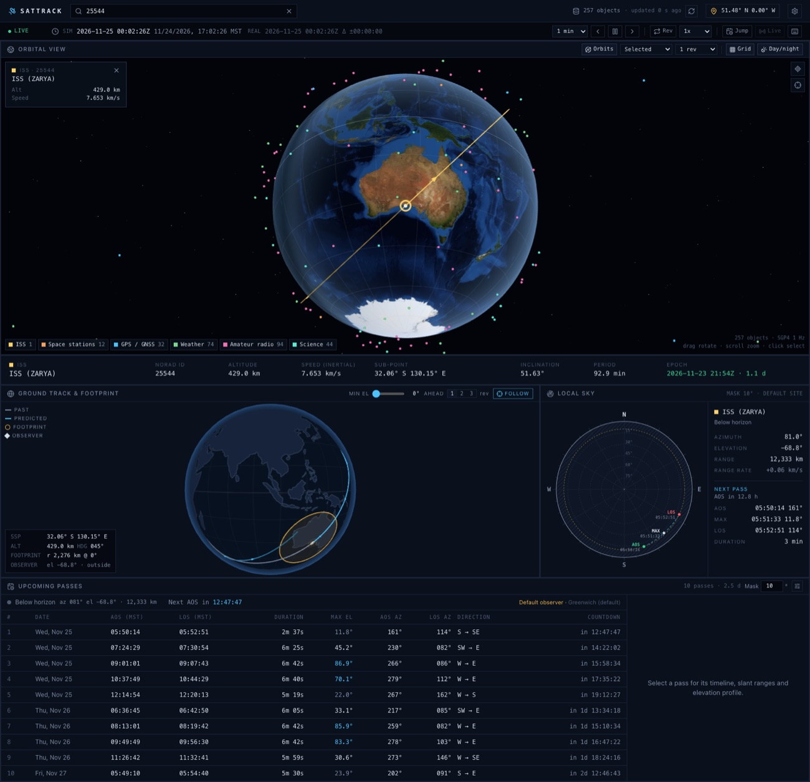
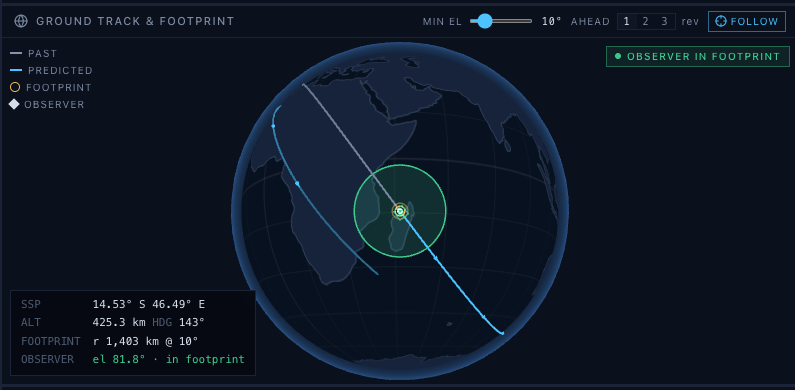
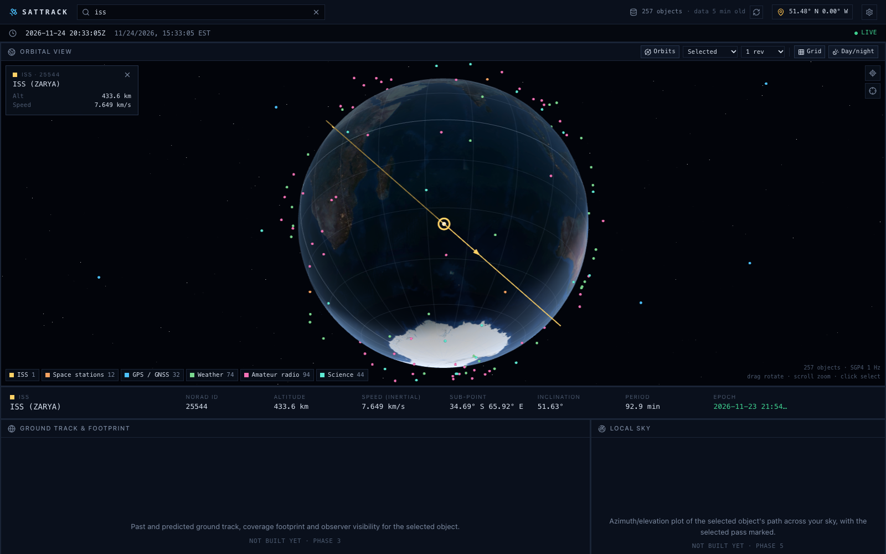
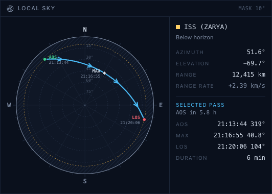
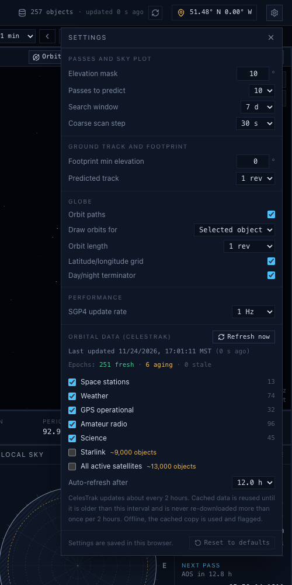

# SatTrack

A local-first satellite tracking and ground station dashboard. It downloads real
orbital elements from [CelesTrak](https://celestrak.org/), propagates them with
SGP4 in the browser, and converts the results into Earth-fixed, geodetic and
observer-relative coordinates. There is no backend, account or API key.

What it does:

- **Primary 3D globe** with every tracked object at its SGP4 position, orbit
  paths, the observer, a lat/lon grid and the day/night terminator.
- **Search and catalog** by name, NORAD id or designator; category filters;
  add or remove objects; CelesTrak groups on demand.
- **Observer location** from the browser, an offline place search, or manual
  latitude / longitude / altitude.
- **Ground track and footprint** on a second globe, with the true
  minimum-elevation coverage contour and observer visibility.
- **Upcoming passes** (AOS, LOS, max elevation, azimuths, direction,
  countdown) from a real scan-and-refine search.
- **Local sky plot** (az/el polar chart) with the live path and pass marks,
  ready for antenna pointing overlays.
- **Time controls**: pause, step, speed, reverse, jump, back to live. Every
  view follows the simulation clock.
- **Settings, persistence, offline operation and error handling** (see
  [Settings and persistence](#settings-and-persistence) and
  [Data refresh, offline use and errors](#data-refresh-offline-use-and-errors)).



## Running locally

Requires Node.js 22.12 or newer.

```sh
npm install
npm run dev        # http://localhost:5173
npm test           # Vitest: orbital math, services, stores (about 260 tests, ~1 s)
npm run build      # type-check + production build into dist/
npm run test:e2e   # build, then Playwright smoke tests against `vite preview`
```

The end-to-end tests need a browser once: `npx playwright install chromium`,
or use an installed Google Chrome with `PW_CHANNEL=chrome npm run test:e2e`.
See [Testing](#testing).

On first launch the app downloads the default catalog groups (space stations,
weather, GPS operational, amateur radio, science; about 250 objects) and caches
them in IndexedDB. Later launches reuse the cache until it is older than the
auto-refresh interval (Settings, default 12 h). Manual refresh is in the header.

## Stack and why

| Concern | Choice | Reason |
|---|---|---|
| UI | React 19, TypeScript, Vite | Spec stack; fast dev server, strict typing. |
| 3D | Three.js + React Three Fiber (+ drei) | Spec stack; R3F keeps scene code declarative while allowing direct buffer/instancing access. |
| State | Zustand | Small, selector-based subscriptions, usable outside React (frame loops, services). |
| Styling | Tailwind CSS v4 | Design tokens in `src/index.css` (`@theme`). |
| SGP4 | [satellite.js](https://github.com/shashwatak/satellite-js) | Maintained port of Vallado's reference SGP4/SDP4. Verified here against Vallado's published vectors. We do not reimplement propagation. |
| Tests | Vitest | Runs the framework-free core in Node. |

`vite.config.ts` sets `worker.format = 'es'` because satellite.js re-exports an
optional WASM build whose worker needs ES-module output. That code is unused
and tree-shaken; the build prints harmless "externalized for browser
compatibility" warnings about it.

## Directory layout

```text
src/
  core/orbit/          Orbital mechanics. No React, no Three.js, no system clock.
    constants.ts       WGS84, Earth rotation rate, time constants
    time-utils.ts      UTC ms <-> Julian date, GMST (IAU-82), TLE epochs, epoch age
    tle-parser.ts      TLE parsing and validation (checksums, ranges, Alpha-5)
    sgp4.ts            satellite.js wrapper: SatRec creation/caching, TEME propagation
    coordinate-transformations.ts  TEME -> ECEF (PEF), ECEF <-> WGS84 geodetic, wrapping
    observer.ts        Observer validation, observer ECEF, ECEF -> ENU
    sky-coordinates.ts Azimuth, elevation, range, range rate
    satellite-propagator.ts  computeSatelliteState, propagateBatch, sampleTrajectory
    pass-prediction.ts AOS / LOS / max-elevation search (scan + bisection + golden section)
    ground-track.ts    Sub-satellite track, antimeridian splitting, ground heading
    footprint.ts       Coverage footprint (true min-elevation contour), observer-in-footprint
    sky-track.ts       Sky-plot look-angle sampling, pointing separation
  services/
    celestrak.ts       CelesTrak GP endpoints, group definitions, typed fetch errors
    satellite-catalog.ts  Cache-first catalog loading, validation, merging
    storage.ts         IndexedDB / localStorage with in-memory fallbacks and fallback status
    catalog-health.ts  Data age, offline state, epoch-age counts, retry timing (pure)
    geolocation.ts     Browser Geolocation API wrapper with typed failures
    place-search.ts    Offline place search over the bundled GeoNames extract
    pass-search.ts     Serializable pass-search job (worker and main-thread fallback)
    pass-scheduler.ts  When to recompute passes; drives the worker
  data/places.json     Bundled place list (built by scripts/build-places.mjs)
  workers/             pass-prediction.worker.ts
  stores/              Zustand stores (see contracts)
  hooks/               React glue: sim time, catalog bootstrap, selected satellite
  types/               Shared types: satellite, orbital, observer, passes, antenna
  components/          One slot file per dashboard panel (see contracts)
  utils/               Formatting, category colors, coordinate input parsing
  tests/               Vitest suites: orbit/, coordinates/, passes/, services/, stores/, location/, sky-plot/, time/
e2e/                   Playwright smoke tests (real CelesTrak data via an on-disk cache)
```

## Coordinate systems and units

| Quantity | Unit / convention |
|---|---|
| Time | UTC milliseconds since the Unix epoch (`number`). Local time only in display formatting. |
| Distance | kilometers in all core math. Observer altitude is stored in **meters** (UI unit) and converted at the boundary (`observerEcef`). |
| Velocity | km/s |
| Angles | radians inside `core/orbit` math; **degrees** in every exported type (`Geodetic`, `LookAngles`, `TleRecord`). |
| Longitude | (-180, 180], east positive (`wrapLongitudeDeg`). |
| Azimuth | [0, 360), clockwise from true north. Reported as 0 at the zenith, where it is undefined. |
| Elevation | Geometric, degrees above the local horizontal plane. No atmospheric refraction. |

### Transformation pipeline

```text
TLE --(satellite.js SGP4, WGS72)--> TEME r, v
TEME --(rotate about z by GMST)--> ECEF (PEF) r; v minus omega x r
ECEF --(WGS84, iterative)--> geodetic lat / lon / alt
ECEF - observer ECEF --(rotate to local axes)--> ENU
ENU --> azimuth = atan2(E, N), elevation = atan2(U, sqrt(E^2 + N^2))
range = |r_sat - r_obs|, range rate = (r_sat - r_obs) . v_sat / range
```

- **TEME** (True Equator, Mean Equinox) is SGP4's output frame, quasi-inertial.
- **ECEF** here is strictly **PEF** (Pseudo Earth Fixed): TEME rotated by
  Greenwich Mean Sidereal Time (IAU 1982 model). Two documented approximations:
  - **No polar motion** (PEF -> ITRF). Effect: up to about 15 m on the surface.
  - **UT1 approximated by UTC.** |UT1 - UTC| < 0.9 s, so up to about 0.4 km
    along the equator.

  Both are far below SGP4's own error (about 1 km at epoch, growing a few km
  per day). The test suite checks the result against Vallado's ITRF reference
  within 0.5 km, and against his PEF reference to sub-meter when UT1 is given.
- **Geodetic** coordinates use the WGS84 ellipsoid. SGP4 itself uses WGS72
  constants because TLEs are fit with them. That is correct and intentional:
  the two are used for different steps.
- **ENU** at the exact geographic poles: north is defined along the entered
  longitude's meridian, continued over the pole. Azimuths there are relative to
  that meridian.

### Element-set freshness

`classifyEpochAge` buckets |simulation time - TLE epoch|: under 3 days is
`fresh`, under 14 days is `aging`, otherwise `stale`. The selected-object strip
colors the epoch accordingly. Records that fail validation or SGP4
initialization are dropped and counted (`CatalogGroupStatus.rejectedCount`),
never silently fixed. Propagation failures (for example a decayed orbit) return
`null` / `ok: false` rather than a position.

## Observer location

The location panel opens from the coordinates button in the header. It shows
the configured location (with a warning while it is still the Greenwich
default) and offers three ways to set it. Every path goes through
`useObserverStore.setLocation`, so it is validated and persisted to
localStorage.

- **Detect My Location** uses the browser Geolocation API
  (`services/geolocation.ts`). It never assumes permission: no API, an
  insecure context (geolocation needs https or localhost), denial, no fix and
  timeout each produce a specific message, and manual entry stays available.
  The fix is labeled with the nearest bundled city within 30 km. Per the W3C
  spec, a reported altitude is meters above the WGS84 ellipsoid and is stored
  as-is. Most desktop browsers report none; the panel then uses the nearest
  city's elevation and says so, or keeps the previous altitude if no city is
  near.
- **Find a place** searches an offline list: every GeoNames place with at least
  100 000 inhabitants plus all national capitals (about 6 400 entries, 150 KB
  gzipped, loaded on first use as its own chunk). Search ignores accents and
  accepts a qualifier after a comma (`Portland, Oregon`, `Paris, FR`). A place
  sets the city-center coordinates and elevation. Data: [GeoNames](https://www.geonames.org/),
  CC BY 4.0. Rebuild it with `node scripts/build-places.mjs <dir>` (instructions
  in the script).
- **Manual entry** takes latitude, longitude and altitude (meters). Coordinates
  accept signed decimal degrees, a hemisphere letter (`40.7128 N`, `74.006W`),
  or degrees/minutes/seconds (`40°42'46"N`). Ranges are checked by
  `validateObserverLocation` with per-field errors.

Altitude reference: GeoNames elevations are above mean sea level, while
`altitudeM` means above the WGS84 ellipsoid. The difference (geoid undulation)
is within about ±100 m worldwide and moves LEO elevation angles by well under
0.01°, so it is documented rather than corrected.

## Pass prediction

`core/orbit/pass-prediction.ts` finds passes from real SGP4 positions. There are
no approximations or canned tables.

1. **Coarse scan.** Elevation (SGP4 TEME, then GMST to ECEF, then observer ENU)
   is sampled every `passScanStepS` (default 30 s) for `passSearchDays`
   (default 7 d). It stops after `passCount` passes. The grid sits on absolute
   multiples of the step, so a recompute samples the same instants.
2. **AOS / LOS.** Bisection on `elevation - mask` in each interval that crosses
   the mask, down to 10 ms.
3. **Maximum elevation.** Golden-section search around the highest sample,
   down to 50 ms.
4. **Grazing passes.** A coarse local maximum within 5° below the mask is
   refined too. A pass shorter than one step is still found (the tests check
   that a 300 s scan matches a 5 s scan).
5. **Pass in progress.** If the satellite is already up at the start, the scan
   steps back up to one orbit to find and refine the real AOS.
   `inProgressAtSearchStart` is set only when no rise exists in that span.
6. **Edge cases.** A satellite that never rises gives `never-above-mask`, with
   the highest elevation sampled. One that never sets (GEO in view) gives
   `always-above-mask`. A pass still open at the window end is followed for up
   to 1 more day to find its LOS.

The observer's latitude, longitude and altitude all enter through observer
ECEF/ENU. Elevation is geometric, with no refraction.

**Off the main thread.** `services/pass-scheduler.ts` runs the search in
`workers/pass-prediction.worker.ts`. A 7-day ISS search takes about 6,000 SGP4
evaluations (around 10 ms). A never-rising object scans the full window. A new
search starts when the selected satellite, its TLE, the observer, or the
mask / count / window / step settings change. It is anchored at the current
simulation time. While time runs, the result is reused. It is recomputed only
when a pass ends, when the clock moves before the search start, or when a
window that found fewer than `passCount` passes has slid by an eighth of its
length. A superseded search is abandoned. A selected pass is followed across
recomputes by matching its peak time. Without Web Worker support the same job
runs on the main thread.

**Validation** (`src/tests/passes/`): AOS/LOS sit on the mask and the maximum
is a true local maximum. Results match an independent 1 s brute-force scan
that uses satellite.js's own `eciToEcf` / `ecfToLookAngles` (within 2 s and
0.05°). Further cases: a near-zenith pass with a ~180° azimuth flip, a
south-polar observer that never sees the ISS, a polar orbiter from 89° N, the
±180° date line, GEO always visible and never visible, decayed elements,
mask nesting, and the recompute rules.

**Panel.** `components/passes/UpcomingPasses.tsx` shows the next passes in
local time (UTC alongside in the details), each with duration, max elevation,
AOS/LOS azimuth, direction and a countdown. A live strip shows whether the
object is visible now (above the mask, above the horizon only, or below it)
and the countdown to the next AOS or LOS. The mask input and a pass-search
popover (count, window, scan step) write to the settings store. Clicking a row
calls `selectPass(id)` and opens `PassDetails.tsx`: AOS / max / LOS events with
local and UTC times, az/el and slant range, min range, range rate, and an
elevation profile with the current time marked.

## Ground track and footprint



The panel under the selected-object strip is a second, Earth-fixed Three.js
globe (`components/ground-track/`). It shows:

- **Ground track**: the sub-satellite point over time, half an orbit of
  history (grey, fading) and 1 to 3 orbits ahead (cyan, with direction
  cones). Points come from `computeGroundTrack` (`core/orbit/ground-track.ts`):
  SGP4 state at each sample time, rotated TEME -> ECEF by GMST at that same
  time, then converted to WGS84 latitude/longitude. Using each sample's own
  GMST is what accounts for the Earth's rotation; the ISS track shifts about
  23 degrees west per revolution, which the tests check. Sampling is about
  240 points per orbit, clamped to 10 s to 5 min, and at most 24 h each way
  (so GEO gives a one-day figure-eight, not thousands of samples).
- **Current sub-satellite point** with latitude, longitude, altitude and
  ground heading (azimuth of the Earth-relative velocity at the sub-point).
- **Coverage footprint** for `settings.footprintMinElevationDeg` (the "Min el"
  slider in the panel header, default 0 = geometric horizon). This is the set
  of surface points that see the satellite at or above that elevation.
  `computeFootprint` (`core/orbit/footprint.ts`) uses the Earth central angle
  `lambda = 90 - e - asin(R cos e / r)` only to bracket a root search: along
  128 azimuths from the sub-point it bisects until the elevation, computed on
  the WGS84 ellipsoid against the geodetic vertical (the same definition used
  for look angles and passes), equals the mask. Every boundary point is on
  the true contour; tests check this to 1e-6 degrees, including GEO (about 81
  degrees of central angle at 0 elevation), a sub-point on a pole, and a
  footprint straddling the date line.
- **Observer**: a diamond marker. When the observer is inside the footprint
  (the satellite is at or above the mask from the observer's real location
  and altitude), the marker, outline and fill turn green and the panel shows
  "Observer in footprint". The readout also gives the observer's current
  elevation of the satellite.

Ground track and footprint are different things: the track is where the
satellite is over time, the footprint is who can see it right now.

Update rates. The track samples are regenerated only when simulation time
leaves the current window (the window widens with the playback rate); the
past/future color split is recomputed in the frame loop when time crosses a
sample. The sub-satellite point and observer visibility are evaluated every
frame (one SGP4 call for one object). The footprint is recomputed when the
satellite has moved more than 5 km or the mask changes. The text readout
refreshes at 2 Hz. "Follow" keeps the camera over the sub-point; dragging the
globe turns it off.

`splitAtAntimeridian` splits a track into runs that do not jump across
+/-180 degrees, with interpolated crossing points, for any 2D map consumer.
The 3D globe does not need it.

Base map: [Natural Earth](https://www.naturalearthdata.com/) 1:110m land
polygons (public domain), stored compactly in
`src/assets/geo/ne-110m-land.json`, loaded lazily and rasterized to an
equirectangular canvas texture with a 15-degree graticule.
## Primary globe and catalog search

`components/globe/` renders the main 3D view with React Three Fiber.

- **Frame.** The scene is TEME, re-axed for Three.js (y = north) and scaled to
  Earth radii (`scene-frame.ts`). The Earth, grid and observer sit in a group
  rotated by `gmstRad`, so satellites drawn at their TEME positions appear over
  the ground point `ecefToGeodetic` reports. Tests check this against Three.js's
  own `SphereGeometry` UVs.
- **Earth.** NASA Blue Marble (day) and Earth at Night textures in
  `public/textures/` (public domain NASA imagery; files taken from the
  three-globe example assets). The mesh is scaled to the WGS84 ellipsoid. The
  day/night terminator uses `core/orbit/sun-position.ts` (Astronomical Almanac
  low-precision Sun, ~0.01 deg).
- **Markers.** One `Points` draw call for all visible objects, colored by
  `CATEGORY_COLORS`. SGP4 runs in a Web Worker (`propagation/`) at
  `settings.propagationHz`, or sooner when simulation time moves more than 20 s.
  Each frame extrapolates with a third-order two-body series
  (`core/orbit/extrapolation.ts`, < 50 m at 20 s). Markers are hidden rather
  than guessed past 120 s from the last batch or when SGP4 fails.
- **Orbits.** Selected path from `sampleTrajectory` (past quarter dimmed); "all
  visible" paths sampled in the worker (`core/orbit/orbit-sampling.ts`). Paths
  regenerate only on selection, element set or setting change, or when the
  clock drifts 20% of the path span.
- **Interaction.** Drag to rotate, scroll to zoom, hover for name and NORAD id,
  click to select. Buttons center on the observer or the selection.
- **Search** (header, press `/`): name, NORAD id or international designator.
  Rows track/untrack; a NORAD number not in the loaded groups can be
  downloaded and tracked. Category chips at the bottom of the globe filter.



## Module contracts

These are the interfaces later work builds on. Keep them stable or update this
section with the change.

**Time.** `stores/time-store.ts` is the only clock for orbital work.
`getSimTimeMs()` outside React, `useSimTimeMs(hz)` in components. Actions:
`pause`, `resume`, `setRate`, `jumpTo`, `step`, `resetToLive`. Store state
changes only when the clock is controlled, not per tick. Orbit code never calls
`Date.now()`. The only wall-clock uses are catalog data age and cache freshness,
which are about real downloads.
`getWallClockMs()` returns real time through the same injectable clock, for
display only (the time bar's offset from real time).

**Catalog and selection.** `stores/satellite-store.ts`:
- `satellites` (everything loaded), `tracked` (minus user-removed), `visible`
  (tracked and category filter on), `byId`. These are stable arrays recomputed
  in actions, so they are safe to subscribe to.
- `selectedId`, `select(id)`, `selectedPassId`, `selectPass(id)`. Changing the
  selection clears the pass. Use `selectSelectedSatellite` as the selector.
- `trackNoradId(id)` (downloads by catalog number if needed), `untrack(id)`,
  `restoreUntracked()`, `setCategoryVisible`, `setGroupEnabled`, `loadCatalog({ force })`.
- Status: `loadState`, `loadError`, `groupStatus`, `lastLoadedAtMs`.

**Observer.** `stores/observer-store.ts`: `location: ObserverLocation`
(degrees, altitude in meters, `source` is `'default'` until the user sets one),
`setLocation(loc)` returns field errors from `validateObserverLocation` and only
stores valid input. Persisted.

**Settings.** `stores/settings-store.ts`: `elevationMaskDeg` (default 10),
`footprintMinElevationDeg`, `passCount`, `passSearchDays`, `passScanStepS`,
`showOrbits`, `orbitScope`, `orbitLengthPeriods`, `showLatLonGrid`,
`showTerminator`, `propagationHz` (default 1), `autoRefreshHours`,
`groundTrackAheadRevs`. `update(patch)` clamps numbers and type-checks the
rest; `reset()` restores `DEFAULT_SETTINGS`. Persisted.

**Orbit math.** Import from `core/orbit/*`, never from satellite.js directly:
- `satrecFor(tle)` returns a cached SGP4 record per `TleRecord` object.
- `computeSatelliteState(satrec, timeMs)` returns a `SatelliteState`
  (TEME, ECEF with true Earth-relative velocity, geodetic, inertial speed,
  GMST) or `null`.
- `propagateBatch(satrecs, timeMs, buffers)` writes TEME positions and
  velocities into `Float64Array`s for bulk rendering. It is worker-friendly:
  move it behind a Web Worker without changing callers' data layout.
- `sampleTrajectory(satrec, startMs, endMs, stepMs)` for orbit paths
  (`teme`) and ground tracks (`geodetic`).
- `computeLookAngles(ecefState, observer)` / `lookAnglesAt(satrec, observer, timeMs)`
  for az/el/range/range rate.
- `gmstRad(timeMs)` to rotate an Earth mesh into TEME, or TEME into ECEF.

**Passes.** `types/passes.ts` defines `Pass` (AOS/LOS/max-elevation times and
azimuths, duration, `track: PassTrackSample[]`) and its `id`
(`${noradId}-${aosMs}`), shared by the passes table and the sky plot.
- `stores/pass-store.ts` holds the predicted passes of the selected satellite:
  `passes`, `result` (status, search window, diagnostics), `state`
  (`idle` / `computing` / `ready` / `error`), `refreshing`.
- Read it with `usePassPredictions()` or `useSelectedPass()`
  (`hooks/use-pass-predictions.ts`). Either hook keeps the shared scheduler
  running, so a panel never needs to start it itself.
- `track` runs from AOS to LOS in time order (about 180 samples, at least 1 s
  apart) and always contains the exact AOS, maximum and LOS instants.
- When nothing is selected, the sky plot can show `currentOrNextPass(passes, now)`
  from `core/orbit/pass-prediction.ts`.
- Result statuses other than `ok`: `never-above-mask`, `always-above-mask`
  (for example a geostationary satellite in view) and `propagation-error`.
  `passes` is empty for all three.

**Dashboard slots.** Each panel is its own file, wrapped in its own
`ErrorBoundary` by `Dashboard.tsx`. Replace the slot's contents and leave
`Dashboard.tsx` / `Header.tsx` alone:

| Slot | File |
|---|---|
| Primary globe | `components/globe/EarthGlobe.tsx` |
| Search | `components/satellite/SatelliteSearch.tsx` |
| Selected-object strip (working) | `components/satellite/SatelliteInfo.tsx` |
| Ground track and footprint | `components/ground-track/GroundTrackGlobe.tsx` |
| Sky plot | `components/sky-plot/SkyPlot.tsx` |
| Upcoming passes | `components/passes/UpcomingPasses.tsx` |
| Location panel (header drawer) | `components/location/LocationSelector.tsx` |
| Time controls bar | `components/layout/TimeControls.tsx` |

`CATEGORY_COLORS` (`utils/category-colors.ts`) is the shared palette for
categories across all views.

## Time controls

The bar under the header drives the simulation clock. Every view reads time
from it, so pausing, scrubbing or jumping moves all of them together.


- **Status.** `LIVE` (green) when running at 1x on real time, `PAUSED`
  (amber), or the current rate such as `60x` / `-600x` (blue).
- **Sim vs real.** The simulation instant in UTC and local time, then `Δ`,
  the simulation time minus real time. Real UTC also shows on wide screens
  and in the tooltip.
- **Step.** Back/forward by the chosen step (10 s to 1 d). Works while paused.
- **Speed.** 1x to 100,000x. `Rev` flips the sign so time runs backward.
- **Jump.** Enter a date and time in local time or UTC. The store only ever
  receives UTC ms. Switching the zone re-expresses the same instant.
  Impossible dates (Feb 30, 24:00) are rejected rather than rolled over.
  Jumping keeps the paused or running state.
- **Live.** Back to real time at 1x, running.

Keyboard (ignored while typing in a field): `Space` pause/resume, `←`/`→`
step, `[`/`]` slower/faster, `R` reverse, `J` jump, `L` live.

Conversions live in `core/orbit/time-utils.ts` (`parseDateTimeInput`,
`formatDateTimeInput`) and are tested in `src/tests/time/` under several time
zones (`TZ=Pacific/Chatham npx vitest run src/tests/time`).

## Local sky plot

`components/sky-plot/SkyPlot.tsx` plots the selected object on an
azimuth/elevation polar chart: zenith at the center, horizon on the outer
ring, north up, east right (the usual ground-station orientation, mirrored
relative to a map). Rings mark 15, 30, 45, 60 and 75 degrees, and the band
below the elevation mask (Settings, default 10 degrees) is hatched.



- **Now.** The current position and a readout of azimuth, elevation, slant
  range and range rate (negative = approaching), from `lookAnglesFast` at
  simulation time.
- **Live path.** Look angles sampled a quarter orbit (10 to 60 min) either
  side of now: past in grey, predicted in the category color with arrows for
  the direction of travel. Only the part above the horizon is drawn; crossings
  are clipped onto the horizon ring.
- **Pass marks.** One pass is annotated with AOS, maximum elevation and LOS
  and their local times: the pass selected in the passes table
  (`selectedPassId`), else the pass in progress, else the next one. When the
  object is below the horizon the next pass is still shown, dashed.
- **Radius.** Linear in zenith angle, `r = R (90 - el) / 90`
  (`components/sky-plot/sky-projection.ts`, tested in `src/tests/sky-plot/`).

Passes come from the shared pass store (`usePassPredictions()` /
`useSelectedPass()`), so the sky plot and the passes table always show the
same AOS / max / LOS. With no pass selected it uses
`currentOrNextPass(passes, now)`. When the search finds nothing it says why
(never above the mask in the window, always above it, or a propagation
error). `core/orbit/sky-track.ts` only samples look angles for the live path
(`sampleSkyTrack`, `lookAnglesFast`) and measures pointing separation.

**Antenna overlay (not connected to hardware).** `SkyPlot` takes an optional
`antenna: AntennaPointing` prop (`types/antenna.ts`) with `commanded` and
`actual` az/el. When given, the chart draws both (commanded dashed amber,
actual white) and the readout shows the pointing error (actual vs satellite)
and tracking error (actual vs commanded). Errors are true angular separations
on the sky (`angularSeparationDeg`), which stay correct near the zenith where
azimuth differences blow up. The dashboard renders `<SkyPlot />` without it
today; a rotator controller only has to supply that prop. `SkyPlotChart` is
exported separately for a future antenna view with its own data.

## Data source etiquette

CelesTrak regenerates GP data about every 2 hours and asks clients not to
download the same data more often. The catalog service enforces a 2-hour floor
even for manual refresh, shares one request between concurrent loads, and falls
back to cached data (with a visible warning) when a download fails. Large
groups (Starlink, all active satellites) are opt-in in Settings.

The app requests TLE format. Catalog numbers above 99999 use Alpha-5 encoding,
which the parser decodes. Moving to OMM JSON (`FORMAT=json`, supported by
`satellite.js`'s `json2satrec`) is the long-term path once the catalog
outgrows TLEs.

## Settings and persistence

The gear button in the header opens one settings panel with every persisted
setting, grouped by what it affects:



| Group | Settings | Default |
|---|---|---|
| Passes and sky plot | Elevation mask, passes to predict, search window, coarse scan step | 10°, 10, 7 d, 30 s |
| Ground track and footprint | Footprint minimum elevation, predicted track length | 0°, 1 rev |
| Globe | Orbit paths on/off, selected or all visible, orbit length, lat/lon grid, day/night terminator | on, selected, 1 rev, on, on |
| Performance | SGP4 update rate for the bulk propagation | 1 Hz |
| Orbital data | Catalog groups, auto-refresh interval, refresh now | 5 groups, 12 h |

The same values can also be changed inline on the panels that use them (the
mask on the passes panel, the orbit toggles on the globe, the footprint slider
on the ground track). Both write to `stores/settings-store.ts`, so they never
disagree. "Reset to defaults" asks for a second click and resets settings
only, not the location, tracked list or cached data.

What is stored where:

| Data | Where | Key |
|---|---|---|
| Settings | localStorage | `sattrack.settings.v1` |
| Observer location | localStorage | `sattrack.observer.v1` |
| Enabled groups, removed and added objects, category filters, selection | localStorage | `sattrack.satellites.v1` |
| Downloaded TLE text and download time, per group / NORAD id | IndexedDB `sattrack` / `kv` | `tle:group:<id>`, `tle:catnr:<id>` |

Stored values are validated on load: numbers are clamped, wrong types and
unparseable JSON fall back to defaults, and fields added in a later version
get their defaults. If localStorage or IndexedDB is unavailable (private
browsing, blocked storage) the app runs on in-memory storage and a notice says
what will not survive the session. The settings panel also lists objects
removed from their groups (with "Restore all") and objects added by NORAD id.

## Data refresh, offline use and errors

**Refresh.** On launch the catalog comes from IndexedDB when it is younger
than the auto-refresh interval; otherwise it is downloaded. A background
check every 5 minutes reloads once the interval has passed. Manual refresh
(header button or "Refresh now") skips the interval but still honors
CelesTrak's 2-hour floor. The header shows the object count, how long ago the
data was downloaded and the most important warning; hovering gives the exact
download time and per-group status. The settings panel shows the last update
in local time.

**Offline.** If a download fails and a cached copy exists, the cached element
sets are used, the header shows `offline · cached` and a notice bar explains
that positions and passes are still computed from them. Failed downloads are
retried every 15 minutes and immediately when the browser reports it is
back online. With no cache at all, the notice gives the actual error and a
Retry button; the globe says the catalog is empty instead of drawing
anything.

**Element-set freshness.** Epoch age is measured against the simulation time,
not the wall clock, so it also catches jumping far into the future or past.
`classifyEpochAge`: fresh under 3 days, aging under 14, stale beyond. The
selected-object strip colors the epoch and, when aging or stale, says what
that means for accuracy. The header counts stale element sets, the settings
panel shows fresh / aging / stale / rejected counts, and when every element
set is stale a notice says so. Records that fail validation or SGP4
initialization are dropped and counted, never patched.

**Errors.** Each dashboard panel and each header drawer has its own error
boundary: a crash shows the panel name, the message and a Retry button, and
the rest of the dashboard keeps working. The two 3D views check for WebGL
first and say so when it is missing, show the renderer error if creating the
WebGL context fails, and offer a Retry when the GPU drops the context.
Passes, the sky plot and the selected-object data do not need WebGL.
Geolocation failures (no API, insecure context, denied, no fix, timeout) each
have their own message in the location panel. Catalog, storage and WebGL
problems are logged to the console with a `[catalog]`, `[storage]`,
`[webgl]` or `[ui]` prefix.

## Testing

**Unit tests** (`npm test`, Vitest, Node). They cover the orbital core
against published references (Vallado SGP4 vectors, GMST and TEME to PEF
examples, an independent satellite.js look-angle path), the services, and
the stores. Spec edge cases and where they are tested:

| Case | Tests |
|---|---|
| International Date Line | `coordinates/edge-cases`, `coordinates/transformations`, `orbit/ground-track`, `orbit/footprint`, `passes/pass-prediction` |
| Directly overhead | `coordinates/edge-cases` (zenith, ISS pass in progress overhead), `coordinates/look-angles`, `passes/pass-prediction` |
| Close to the horizon | `coordinates/edge-cases` (0° plane, below horizon, grazing pass 0.05° over the mask), `sky-plot/projection` |
| Polar observers | `coordinates/edge-cases` (GEO invisible from the pole, footprint over the pole), `coordinates/look-angles`, `passes/pass-prediction` |
| Geostationary | `coordinates/edge-cases` (zenith, due south / north), `orbit/propagator`, `orbit/footprint`, `orbit/ground-track`, `passes/pass-prediction` |
| Never above the mask | `passes/pass-prediction`, `coordinates/edge-cases` |
| Pass in progress | `coordinates/edge-cases`, `passes/pass-prediction`, `passes/pass-scheduler` |
| Time zones | `time/time-zones` (half-hour and 45-minute offsets, DST change, date rollover), `time/time-controls` |
| Persistence | `stores/persistence` (reload round trips, corrupted and older stored data) |
| Data health | `services/catalog-health`, `services/satellite-catalog` |

**End-to-end smoke tests** (`npm run test:e2e`, Playwright, `e2e/`). They run
the production build in Chromium with software WebGL and check that:

- real data loads and every panel renders (globe canvas drawn, ISS altitude
  330 to 460 km, speed 7.5 to 7.8 km/s, inclination 51.6°, at least 5 passes,
  sky plot, ground track), with no uncaught page errors;
- settings, the manual location and the selection survive a reload, and
  reset to defaults persists;
- offline with no cache shows the error and Retry recovers;
- offline with an expired cache falls back to it and says so;
- without WebGL, both 3D views explain why and the other panels still work.

CelesTrak requests in these tests go through `e2e/celestrak-cache.ts`: the
first request for a URL downloads real data and stores it in `e2e/.cache/`
(git-ignored) for 12 hours, so repeated runs stay within CelesTrak's
once-per-2-hours policy. The run needs network access the first time.

## Known limitations

- **TEME to Earth-fixed uses GMST only** (IAU 1982), with UT1 taken as UTC
  and no polar motion. Error is under about 0.5 km, well below SGP4's own
  error, but this is not a full IAU 2006/2000A ITRF reduction.
- **SGP4 accuracy** is about 1 km at epoch and grows by a few km per day.
  Element sets more than a couple of weeks from the displayed time are
  flagged, not corrected. Decayed objects stop propagating and are reported.
- **Geometric elevation only.** No atmospheric refraction (about 0.5° at the
  horizon), so real AOS is a little earlier and LOS a little later than shown.
- **No optical visibility.** Passes are geometric; whether the satellite is
  sunlit and the observer is in darkness is not computed.
- **Altitude reference.** Place elevations are above mean sea level but used
  as height above the WGS84 ellipsoid (up to about ±100 m difference;
  negligible for look angles).
- **TLE format.** Data is requested as TLE; objects beyond Alpha-5 catalog
  numbers will need the OMM JSON path.
- **Large groups.** "All active satellites" (about 13,000 objects) works but
  is opt-in; first load downloads and parses it on the main thread.
- **Storage limits.** If the browser evicts IndexedDB, the next launch simply
  downloads again.

