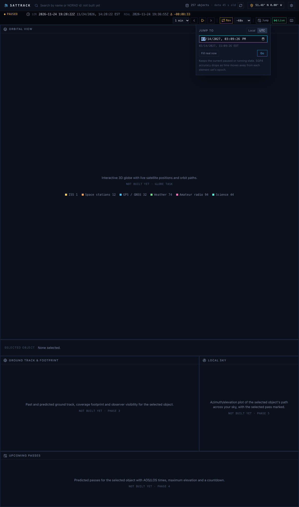

# SatTrack

A local-first satellite tracking and ground station dashboard. It downloads real
orbital elements from [CelesTrak](https://celestrak.org/), propagates them with
SGP4 in the browser, and converts the results into Earth-fixed, geodetic and
observer-relative coordinates. There is no backend, account or API key.

This is the **foundation** build: project scaffold, dashboard shell, shared
types and stores, the CelesTrak catalog service, and the orbital mechanics
core with tests. The globe, location panel, ground track, passes, sky plot and
time controls are built on top of it as separate pieces of work (see
[Module contracts](#module-contracts)). Their panels currently say so instead
of showing placeholder data.

## Running locally

Requires Node.js 22.12 or newer.

```sh
npm install
npm run dev      # http://localhost:5173
npm test         # Vitest, core math and services
npm run build    # type-check + production build into dist/
```

On first launch the app downloads the default catalog groups (space stations,
weather, GPS operational, amateur radio, science; about 250 objects) and caches
them in IndexedDB. Later launches reuse the cache until it is older than the
auto-refresh interval (Settings, default 12 h). Manual refresh is in the header.

## Stack and why

| Concern | Choice | Reason |
|---|---|---|
| UI | React 19, TypeScript, Vite | Spec stack; fast dev server, strict typing. |
| 3D | Three.js + React Three Fiber (+ drei) | Spec stack; R3F keeps scene code declarative while allowing direct buffer/instancing access. |
| State | Zustand | Small, selector-based subscriptions, usable outside React (frame loops, services). |
| Styling | Tailwind CSS v4 | Design tokens in `src/index.css` (`@theme`). |
| SGP4 | [satellite.js](https://github.com/shashwatak/satellite-js) | Maintained port of Vallado's reference SGP4/SDP4. Verified here against Vallado's published vectors. We do not reimplement propagation. |
| Tests | Vitest | Runs the framework-free core in Node. |

`vite.config.ts` sets `worker.format = 'es'` because satellite.js re-exports an
optional WASM build whose worker needs ES-module output. That code is unused
and tree-shaken; the build prints harmless "externalized for browser
compatibility" warnings about it.

## Directory layout

```text
src/
  core/orbit/          Orbital mechanics. No React, no Three.js, no system clock.
    constants.ts       WGS84, Earth rotation rate, time constants
    time-utils.ts      UTC ms <-> Julian date, GMST (IAU-82), TLE epochs, epoch age
    tle-parser.ts      TLE parsing and validation (checksums, ranges, Alpha-5)
    sgp4.ts            satellite.js wrapper: SatRec creation/caching, TEME propagation
    coordinate-transformations.ts  TEME -> ECEF (PEF), ECEF <-> WGS84 geodetic, wrapping
    observer.ts        Observer validation, observer ECEF, ECEF -> ENU
    sky-coordinates.ts Azimuth, elevation, range, range rate
    satellite-propagator.ts  computeSatelliteState, propagateBatch, sampleTrajectory
    pass-prediction.ts AOS / LOS / max-elevation search (scan + bisection + golden section)
  services/
    celestrak.ts       CelesTrak GP endpoints, group definitions, typed fetch errors
    satellite-catalog.ts  Cache-first catalog loading, validation, merging
    storage.ts         IndexedDB / localStorage with in-memory fallbacks
    geolocation.ts     Browser Geolocation API wrapper with typed failures
    place-search.ts    Offline place search over the bundled GeoNames extract
    pass-search.ts     Serializable pass-search job (worker and main-thread fallback)
    pass-scheduler.ts  When to recompute passes; drives the worker
  data/places.json     Bundled place list (built by scripts/build-places.mjs)
  workers/             pass-prediction.worker.ts
  stores/              Zustand stores (see contracts)
  hooks/               React glue: sim time, catalog bootstrap, selected satellite
  types/               Shared types: satellite, orbital, observer, passes
  components/          One slot file per dashboard panel (see contracts)
  utils/               Formatting, category colors, coordinate input parsing
  tests/               Vitest suites: orbit/, coordinates/, passes/, services/, stores/, location/
```

## Coordinate systems and units

| Quantity | Unit / convention |
|---|---|
| Time | UTC milliseconds since the Unix epoch (`number`). Local time only in display formatting. |
| Distance | kilometers in all core math. Observer altitude is stored in **meters** (UI unit) and converted at the boundary (`observerEcef`). |
| Velocity | km/s |
| Angles | radians inside `core/orbit` math; **degrees** in every exported type (`Geodetic`, `LookAngles`, `TleRecord`). |
| Longitude | (-180, 180], east positive (`wrapLongitudeDeg`). |
| Azimuth | [0, 360), clockwise from true north. Reported as 0 at the zenith, where it is undefined. |
| Elevation | Geometric, degrees above the local horizontal plane. No atmospheric refraction. |

### Transformation pipeline

```text
TLE --(satellite.js SGP4, WGS72)--> TEME r, v
TEME --(rotate about z by GMST)--> ECEF (PEF) r; v minus omega x r
ECEF --(WGS84, iterative)--> geodetic lat / lon / alt
ECEF - observer ECEF --(rotate to local axes)--> ENU
ENU --> azimuth = atan2(E, N), elevation = atan2(U, sqrt(E^2 + N^2))
range = |r_sat - r_obs|, range rate = (r_sat - r_obs) . v_sat / range
```

- **TEME** (True Equator, Mean Equinox) is SGP4's output frame, quasi-inertial.
- **ECEF** here is strictly **PEF** (Pseudo Earth Fixed): TEME rotated by
  Greenwich Mean Sidereal Time (IAU 1982 model). Two documented approximations:
  - **No polar motion** (PEF -> ITRF). Effect: up to about 15 m on the surface.
  - **UT1 approximated by UTC.** |UT1 - UTC| < 0.9 s, so up to about 0.4 km
    along the equator.

  Both are far below SGP4's own error (about 1 km at epoch, growing a few km
  per day). The test suite checks the result against Vallado's ITRF reference
  within 0.5 km, and against his PEF reference to sub-meter when UT1 is given.
- **Geodetic** coordinates use the WGS84 ellipsoid. SGP4 itself uses WGS72
  constants because TLEs are fit with them. That is correct and intentional:
  the two are used for different steps.
- **ENU** at the exact geographic poles: north is defined along the entered
  longitude's meridian, continued over the pole. Azimuths there are relative to
  that meridian.

### Element-set freshness

`classifyEpochAge` buckets |simulation time - TLE epoch|: under 3 days is
`fresh`, under 14 days is `aging`, otherwise `stale`. The selected-object strip
colors the epoch accordingly. Records that fail validation or SGP4
initialization are dropped and counted (`CatalogGroupStatus.rejectedCount`),
never silently fixed. Propagation failures (for example a decayed orbit) return
`null` / `ok: false` rather than a position.

## Observer location

The location panel opens from the coordinates button in the header. It shows
the configured location (with a warning while it is still the Greenwich
default) and offers three ways to set it. Every path goes through
`useObserverStore.setLocation`, so it is validated and persisted to
localStorage.

- **Detect My Location** uses the browser Geolocation API
  (`services/geolocation.ts`). It never assumes permission: no API, an
  insecure context (geolocation needs https or localhost), denial, no fix and
  timeout each produce a specific message, and manual entry stays available.
  The fix is labeled with the nearest bundled city within 30 km. Per the W3C
  spec, a reported altitude is meters above the WGS84 ellipsoid and is stored
  as-is. Most desktop browsers report none; the panel then uses the nearest
  city's elevation and says so, or keeps the previous altitude if no city is
  near.
- **Find a place** searches an offline list: every GeoNames place with at least
  100 000 inhabitants plus all national capitals (about 6 400 entries, 150 KB
  gzipped, loaded on first use as its own chunk). Search ignores accents and
  accepts a qualifier after a comma (`Portland, Oregon`, `Paris, FR`). A place
  sets the city-center coordinates and elevation. Data: [GeoNames](https://www.geonames.org/),
  CC BY 4.0. Rebuild it with `node scripts/build-places.mjs <dir>` (instructions
  in the script).
- **Manual entry** takes latitude, longitude and altitude (meters). Coordinates
  accept signed decimal degrees, a hemisphere letter (`40.7128 N`, `74.006W`),
  or degrees/minutes/seconds (`40°42'46"N`). Ranges are checked by
  `validateObserverLocation` with per-field errors.

Altitude reference: GeoNames elevations are above mean sea level, while
`altitudeM` means above the WGS84 ellipsoid. The difference (geoid undulation)
is within about ±100 m worldwide and moves LEO elevation angles by well under
0.01°, so it is documented rather than corrected.

## Pass prediction

`core/orbit/pass-prediction.ts` finds passes from real SGP4 positions. There are
no approximations or canned tables.

1. **Coarse scan.** Elevation (SGP4 TEME, then GMST to ECEF, then observer ENU)
   is sampled every `passScanStepS` (default 30 s) for `passSearchDays`
   (default 7 d). It stops after `passCount` passes. The grid sits on absolute
   multiples of the step, so a recompute samples the same instants.
2. **AOS / LOS.** Bisection on `elevation - mask` in each interval that crosses
   the mask, down to 10 ms.
3. **Maximum elevation.** Golden-section search around the highest sample,
   down to 50 ms.
4. **Grazing passes.** A coarse local maximum within 5° below the mask is
   refined too. A pass shorter than one step is still found (the tests check
   that a 300 s scan matches a 5 s scan).
5. **Pass in progress.** If the satellite is already up at the start, the scan
   steps back up to one orbit to find and refine the real AOS.
   `inProgressAtSearchStart` is set only when no rise exists in that span.
6. **Edge cases.** A satellite that never rises gives `never-above-mask`, with
   the highest elevation sampled. One that never sets (GEO in view) gives
   `always-above-mask`. A pass still open at the window end is followed for up
   to 1 more day to find its LOS.

The observer's latitude, longitude and altitude all enter through observer
ECEF/ENU. Elevation is geometric, with no refraction.

**Off the main thread.** `services/pass-scheduler.ts` runs the search in
`workers/pass-prediction.worker.ts`. A 7-day ISS search takes about 6,000 SGP4
evaluations (around 10 ms). A never-rising object scans the full window. A new
search starts when the selected satellite, its TLE, the observer, or the
mask / count / window / step settings change. It is anchored at the current
simulation time. While time runs, the result is reused. It is recomputed only
when a pass ends, when the clock moves before the search start, or when a
window that found fewer than `passCount` passes has slid by an eighth of its
length. A superseded search is abandoned. A selected pass is followed across
recomputes by matching its peak time. Without Web Worker support the same job
runs on the main thread.

**Validation** (`src/tests/passes/`): AOS/LOS sit on the mask and the maximum
is a true local maximum. Results match an independent 1 s brute-force scan
that uses satellite.js's own `eciToEcf` / `ecfToLookAngles` (within 2 s and
0.05°). Further cases: a near-zenith pass with a ~180° azimuth flip, a
south-polar observer that never sees the ISS, a polar orbiter from 89° N, the
±180° date line, GEO always visible and never visible, decayed elements,
mask nesting, and the recompute rules.

**Panel.** `components/passes/UpcomingPasses.tsx` shows the next passes in
local time (UTC alongside in the details), each with duration, max elevation,
AOS/LOS azimuth, direction and a countdown. A live strip shows whether the
object is visible now (above the mask, above the horizon only, or below it)
and the countdown to the next AOS or LOS. The mask input and a pass-search
popover (count, window, scan step) write to the settings store. Clicking a row
calls `selectPass(id)` and opens `PassDetails.tsx`: AOS / max / LOS events with
local and UTC times, az/el and slant range, min range, range rate, and an
elevation profile with the current time marked.

## Module contracts

These are the interfaces later work builds on. Keep them stable or update this
section with the change.

**Time.** `stores/time-store.ts` is the only clock for orbital work.
`getSimTimeMs()` outside React, `useSimTimeMs(hz)` in components. Actions:
`pause`, `resume`, `setRate`, `jumpTo`, `step`, `resetToLive`. Store state
changes only when the clock is controlled, not per tick. Orbit code never calls
`Date.now()`. The only wall-clock uses are catalog data age and cache freshness,
which are about real downloads.
`getWallClockMs()` returns real time through the same injectable clock, for
display only (the time bar's offset from real time).

**Catalog and selection.** `stores/satellite-store.ts`:
- `satellites` (everything loaded), `tracked` (minus user-removed), `visible`
  (tracked and category filter on), `byId`. These are stable arrays recomputed
  in actions, so they are safe to subscribe to.
- `selectedId`, `select(id)`, `selectedPassId`, `selectPass(id)`. Changing the
  selection clears the pass. Use `selectSelectedSatellite` as the selector.
- `trackNoradId(id)` (downloads by catalog number if needed), `untrack(id)`,
  `setCategoryVisible`, `setGroupEnabled`, `loadCatalog({ force })`.
- Status: `loadState`, `loadError`, `groupStatus`, `lastLoadedAtMs`.

**Observer.** `stores/observer-store.ts`: `location: ObserverLocation`
(degrees, altitude in meters, `source` is `'default'` until the user sets one),
`setLocation(loc)` returns field errors from `validateObserverLocation` and only
stores valid input. Persisted.

**Settings.** `stores/settings-store.ts`: `elevationMaskDeg` (default 10),
`footprintMinElevationDeg`, `passCount`, `passSearchDays`, `passScanStepS`,
`showOrbits`, `orbitScope`, `orbitLengthPeriods`, `showLatLonGrid`,
`showTerminator`, `propagationHz` (default 1), `autoRefreshHours`.
`update(patch)` clamps values. Persisted.

**Orbit math.** Import from `core/orbit/*`, never from satellite.js directly:
- `satrecFor(tle)` returns a cached SGP4 record per `TleRecord` object.
- `computeSatelliteState(satrec, timeMs)` returns a `SatelliteState`
  (TEME, ECEF with true Earth-relative velocity, geodetic, inertial speed,
  GMST) or `null`.
- `propagateBatch(satrecs, timeMs, buffers)` writes TEME positions and
  velocities into `Float64Array`s for bulk rendering. It is worker-friendly:
  move it behind a Web Worker without changing callers' data layout.
- `sampleTrajectory(satrec, startMs, endMs, stepMs)` for orbit paths
  (`teme`) and ground tracks (`geodetic`).
- `computeLookAngles(ecefState, observer)` / `lookAnglesAt(satrec, observer, timeMs)`
  for az/el/range/range rate.
- `gmstRad(timeMs)` to rotate an Earth mesh into TEME, or TEME into ECEF.

**Passes.** `types/passes.ts` defines `Pass` (AOS/LOS/max-elevation times and
azimuths, duration, `track: PassTrackSample[]`) and its `id`
(`${noradId}-${aosMs}`), shared by the passes table and the sky plot.
- `stores/pass-store.ts` holds the predicted passes of the selected satellite:
  `passes`, `result` (status, search window, diagnostics), `state`
  (`idle` / `computing` / `ready` / `error`), `refreshing`.
- Read it with `usePassPredictions()` or `useSelectedPass()`
  (`hooks/use-pass-predictions.ts`). Either hook keeps the shared scheduler
  running, so a panel never needs to start it itself.
- `track` runs from AOS to LOS in time order (about 180 samples, at least 1 s
  apart) and always contains the exact AOS, maximum and LOS instants.
- When nothing is selected, the sky plot can show `currentOrNextPass(passes, now)`
  from `core/orbit/pass-prediction.ts`.
- Result statuses other than `ok`: `never-above-mask`, `always-above-mask`
  (for example a geostationary satellite in view) and `propagation-error`.
  `passes` is empty for all three.

**Dashboard slots.** Each panel is its own file. Replace the slot's contents and
leave `Dashboard.tsx` / `Header.tsx` alone:

| Slot | File |
|---|---|
| Primary globe | `components/globe/EarthGlobe.tsx` |
| Search | `components/satellite/SatelliteSearch.tsx` |
| Selected-object strip (working) | `components/satellite/SatelliteInfo.tsx` |
| Ground track and footprint | `components/ground-track/GroundTrackGlobe.tsx` |
| Sky plot | `components/sky-plot/SkyPlot.tsx` |
| Upcoming passes | `components/passes/UpcomingPasses.tsx` |
| Location panel (header drawer) | `components/location/LocationSelector.tsx` |
| Time controls bar | `components/layout/TimeControls.tsx` |

`CATEGORY_COLORS` (`utils/category-colors.ts`) is the shared palette for
categories across all views.

## Time controls

The bar under the header drives the simulation clock. Every view reads time
from it, so pausing, scrubbing or jumping moves all of them together.



- **Status.** `LIVE` (green) when running at 1x on real time, `PAUSED`
  (amber), or the current rate such as `60x` / `-600x` (blue).
- **Sim vs real.** The simulation instant in UTC and local time, then `Δ`,
  the simulation time minus real time. Real UTC also shows on wide screens
  and in the tooltip.
- **Step.** Back/forward by the chosen step (10 s to 1 d). Works while paused.
- **Speed.** 1x to 100,000x. `Rev` flips the sign so time runs backward.
- **Jump.** Enter a date and time in local time or UTC. The store only ever
  receives UTC ms. Switching the zone re-expresses the same instant.
  Impossible dates (Feb 30, 24:00) are rejected rather than rolled over.
  Jumping keeps the paused or running state.
- **Live.** Back to real time at 1x, running.

Keyboard (ignored while typing in a field): `Space` pause/resume, `←`/`→`
step, `[`/`]` slower/faster, `R` reverse, `J` jump, `L` live.

Conversions live in `core/orbit/time-utils.ts` (`parseDateTimeInput`,
`formatDateTimeInput`) and are tested in `src/tests/time/` under several time
zones (`TZ=Pacific/Chatham npx vitest run src/tests/time`).

## Data source etiquette

CelesTrak regenerates GP data about every 2 hours and asks clients not to
download the same data more often. The catalog service enforces a 2-hour floor
even for manual refresh, shares one request between concurrent loads, and falls
back to cached data (with a visible warning) when a download fails. Large
groups (Starlink, all active satellites) are opt-in in Settings.

The app requests TLE format. Catalog numbers above 99999 use Alpha-5 encoding,
which the parser decodes. Moving to OMM JSON (`FORMAT=json`, supported by
`satellite.js`'s `json2satrec`) is the long-term path once the catalog
outgrows TLEs.
